# System Architecture: Box Dimensioning & Volumetric-Weight Billing

This document provides a comprehensive, verified architectural map of the **Box Dimensioning from Phone Video** system, detailing the actual components, data pipelines, model inference paths, and mathematical transformations implemented in the codebase.

---

## 1. End-to-End System Architecture Diagram

```mermaid
flowchart TD
    subgraph Inputs["1. Video & Image Ingestion Layer"]
        A1["📂 Objectron Test Dataset<br/>(cereal_box, book)"]
        A2["📸 Browser / Phone Camera<br/>(st.camera_input)"]
        A3["💻 Physical Laptop Webcam<br/>(DirectShow cv2.VideoCapture)"]
        A4["🎬 Uploaded Mobile Video<br/>(.mp4, .mov, .avi)"]
        A5["👁️ Simulated Synthetic Stream<br/>(Desk & Box Simulator)"]
    end

    subgraph Calibration["2. Camera Geometry & Intrinsics Layer"]
        B1["CameraCalibrator<br/>(OpenCV 9x6 Chessboard)"] -->|RMS <= 0.60 px| K1["Intrinsic Matrix K (fx, fy, cx, cy)"]
        B2["Smart Intrinsics<br/>(EXIF & Phone DB 200+ models)"] --> K1
        B3["AR Capture Metadata<br/>(Google ARCore / ARKit)"] -->|View & Projection Mat| K2["World-to-Camera [R|t]"]
    end

    subgraph Quality["3. Quality Gate & Preprocessing Layer"]
        C1["QualityGate.compute_blur_score<br/>(Variance of Laplacian)"]
        C2["QualityGate.check_truncation<br/>(8px boundary boundary test)"]
        C3["Keyframe Selector<br/>(Baseline 5-15 cm separation)"]
    end

    subgraph Detection["4. Object Detection & Corner Localization Layer"]
        D1["DeepBoxDetector<br/>(Priority 1: custom_box_corner_pose.pt)"]
        D2["DeepBoxDetector<br/>(Priority 2: custom_box_yolo.pt)"]
        D3["DeepBoxDetector<br/>(Priority 3: YOLOv8n ONNX)"]
        D4["ClassicalBoxSegmenter<br/>(Hough Lines & Shi-Tomasi Fallback)"]
    end

    subgraph Reconstruction["5. 3D Geometric Reconstruction Engines"]
        subgraph MethodA["Method A: Multi-View Geometric (F3)"]
            E1["Feature & Corner Matcher<br/>(SIFT + Epipolar Line Filtering)"]
            E2["DLT Triangulation<br/>(Direct Linear Transform via SVD)"]
            E3["Cuboid Fitting<br/>(PCA / SVD on 3D Point Cloud)"]
        end

        subgraph MethodB["Method B: Single-View Metrology (F4)"]
            F1["Ground Plane Estimator<br/>(AR Plane / RANSAC)"]
            F2["Ground Raycasting<br/>(Pinhole Ray-Plane Intersection)"]
            F3["Scale Anchor Resolver<br/>(A4 / Credit Card Reference Object)"]
        end
    end

    subgraph Measurement["6. Dimensioning & Billing Engine"]
        G1["Box Dimensions in cm<br/>(Length >= Width >= Height)"]
        G2["Volumetric Weight Calculator<br/>VW = (L × W × H) / 5000 kg"]
        G3["Quality Verification Gate<br/>(ACCEPTED vs REJECTED)"]
    end

    subgraph Visualization["7. Visualization & UI Layer (live_app.py)"]
        H1["Stage 1: 📷 Raw Frame"]
        H2["Stage 2: 🤖 YOLO BBox ROI"]
        H3["Stage 3: 🔍 Detected 2D Corners (D1-D8)"]
        H4["Stage 4: 🧊 Reprojected 3D Cuboid (1-8 Badges & 12 Edges)"]
        H5["Interactive 3D Digital Twin<br/>(Plotly WebGL Mesh)"]
        H6["Standardized JSON Output<br/>(Courier API Payload)"]
    end

    %% Flow connections
    Inputs --> Calibration
    Calibration --> Quality
    Quality --> Detection
    Detection --> Reconstruction
    Reconstruction --> Measurement
    Measurement --> Visualization
```



---

## 2. Pipeline Execution Stages & Responsible Code Modules

| Stage | Operation | Implementing File | Primary Class / Function | Inputs Received | Outputs Produced | Consumers | Working Status |
| :--- | :--- | :--- | :--- | :--- | :--- | :--- | :--- |
| **1. Source Loading** | Ingest video or stream | `live_app.py`, `downloader.py` | `load_sequence`, `cv2.VideoCapture` | Selected sequence, video file, or camera ID | Raw BGR frames + AR metadata | Frame Selector | **WORKING** |
| **2. Intrinsics** | Recover $K$, distortion | `camera_calibrator.py`, `smart_intrinsics.py` | `CameraCalibrator.calibrate`, `estimate_intrinsics_smart` | 14 chessboard images or EXIF tags | $3 \times 3$ Matrix $K$, $k_1..k_5$ distortion | DLT, Raycaster, Renderer | **WORKING** |
| **3. Quality Gating** | Filter blur & truncation | `quality_gate.py` | `QualityGate.validate_frame` | Raw frame, 2D corner candidates | `QualityReport` (status, blur score) | Pipeline flow | **WORKING** |
| **4. 2D Detection** | Bounding box & ROI | `deep_detector.py` | `DeepBoxDetector.detect` | BGR Image ($H \times W \times 3$) | Bounding box $(x, y, w, h)$, conf | Stage 2, Tracker | **WORKING** |
| **5. Corner Localization** | 8 2D vertices ($D_1..D_8$) | `deep_detector.py` | `_detect_custom_pose` | BGR Image ($256 \times 256$ input) | $(8, 2)$ corner coordinates | Stage 3, Triangulation | **WORKING** |
| **6. Method A Matching** | Match points across views | `method_a_multiview.py` | `match_features_and_corners` | Frame 1, Frame 2, 2D corners | Matched correspondences $(N, 2)$ | DLT Triangulator | **PARTIAL** (Fragile on raw clutter) |
| **7. Triangulation** | 3D point cloud via SVD | `method_a_multiview.py` | `triangulate_points` | Matched 2D points, Camera poses $M_1, M_2$ | 3D points $(N, 3)$ in world frame | Cuboid Fitter | **WORKING** |
| **8. Cuboid Fitting** | Fit 3D bounding box | `method_a_multiview.py`, `box_geometry.py` | `fit_cuboid`, `Box.fit` | $(N, 3)$ 3D coordinates | Oriented `Box` instance (rot, trans, scale) | Dimensioner | **WORKING** |
| **9. Method B Metrology** | Single-view raycasting | `method_b_singleview.py` | `MethodBSingleView.measure` | Single frame, AR ground plane | Unprojected 3D base points | Scale Anchor | **POOR SCALE ACCURACY** (MAE 29.2cm) |
| **10. Volumetric Weight** | Billing calculation | `box_geometry.py` | `compute_volumetric_weight` | Length, Width, Height (cm) | Weight in kg ($L \times W \times H / 5000$) | UI Card, JSON | **WORKING** |
| **11. 4-Stage Rendering** | HUD & Wireframe | `live_app.py`, `dimensioner.py` | `render_wireframe_with_overlay` | Frame, 2D wireframe coords | 4 image tabs (Raw, BBox, Corners, 3D Cuboid) | Streamlit UI | **WORKING** |
| **12. 3D Digital Twin** | Interactive Plotly Mesh | `box_3d_renderer.py` | `create_interactive_3d_plotly_figure` | Box dimensions $(L, W, H)$ | Interactive 3D Plotly WebGL figure | Streamlit UI | **WORKING** |

---

## 3. Data Flow Architecture

### 3.1 Method A (Multi-View Geometric Triangulation)

```
Video Stream ──► Frame Pair Selection (Baseline 10-20 cm)
                      ├── Frame 1 (t1) ──► Deep 8-Corner YOLO / SIFT
                      └── Frame 2 (t2) ──► Deep 8-Corner YOLO / SIFT
                                                 │
                                 Epipolar Line Constraint (F2 = K^-T [t]_x R K^-1)
                                                 │
                                         Filtered Matches
                                                 │
                                      Direct Linear Transform (DLT)
                                        [A] X_world = 0  (via SVD)
                                                 │
                                         3D Point Cloud (X, Y, Z)
                                                 │
                                       Singular Value Decomposition
                                            PCA Cuboid Fit
                                                 │
                                     Oriented 3D Bounding Box
                                  (Length, Width, Height in cm)
                                                 │
                                      Volumetric Weight (kg)
```

### 3.2 Method B (Single-View Ground Plane Metrology)

```
Single Frame ──► 2D Corner Localization
                      │
           AR Plane Detection / RANSAC Ground Plane (n.T * X + d = 0)
                      │
               Pinhole Raycasting:
               Ray(t) = C + t * (R_c2w * K^-1 * [u, v, 1]^T)
               t = (-d - n.T * C) / (n.T * Ray_dir)
                      │
               3D Ground Footprint Points
                      │
        Height Unprojection / Scale Anchor Module (A4/Credit Card Reference)
                      │
               Fitted 3D Box & Volumetric Weight
```

---

## 4. Model Inference Flow

```
Input Image (H x W x 3)
      │
      ├──► Priority 1: models/custom_box_corner_pose.pt (Ultralytics YOLOv8n-pose, 6.47 MB)
      │         │
      │         ├── Found Box & 8 Keypoints (conf >= 0.25)?
      │         │     ├── YES ──► Output: BBox (x,y,w,h) + 8 Exact 2D Corners (D1..D8)
      │         │     └── NO  ──► Fallback to Priority 2
      │
      ├──► Priority 2: models/custom_box_yolo.pt (Ultralytics YOLOv8n, 6.46 MB)
      │         │
      │         ├── Found Box (conf >= 0.25)?
      │         │     ├── YES ──► Output: BBox (x,y,w,h) + 4 Rect BBox Corners
      │         │     └── NO  ──► Fallback to Priority 3
      │
      ├──► Priority 3: General YOLOv8n ONNX (~6.2 MB via onnxruntime)
      │         │
      │         ├── Found Suitcase/Book/Table (conf >= 0.25)?
      │         │     ├── YES ──► Output: BBox (x,y,w,h) + 4 Rect BBox Corners
      │         │     └── NO  ──► Fallback to Priority 4
      │
      └──► Priority 4: Classical Hough Line Intersections + Canny Edges
                │
                └── Output: Geometric contour vertices or 8 Shi-Tomasi feature points
```

---

## 5. Live Tracking & Hardware Camera Flow

In the physical webcam and browser camera modes (`CameraBoxTracker`):

1. **State Machine**:
   - `INITIALIZING`: Runs `DeepBoxDetector` on consecutive frames until a confident box is localized.
   - `TRACKING`: Initializes OpenCV tracking (`cv2.TrackerCSRT` or `TrackerKCF` / optical flow) on the bounding box to maintain smooth 30+ FPS without running deep neural network inference on every frame.
   - `PERIODIC RE-DETECTION`: Every 30 frames (`detection_interval`), runs `DeepBoxDetector` to correct tracking drift.
   - `LOST`: If tracking confidence drops or box exits the frame, switches to `LOST` and searches for the object.
2. **Temporal Smoothing**:
   - Applies exponential moving average filter (`alpha = 0.35`) to corner pixel coordinates to eliminate jitter.
3. **Perspective Cuboid Reconstruction**:
   - Uses focal length $f = \frac{\max(w, h)}{2 \tan(\text{FOV}/2)}$ and target distance ($d \approx 60$ cm) to back-project 2D corners into metric 3D coordinates.
