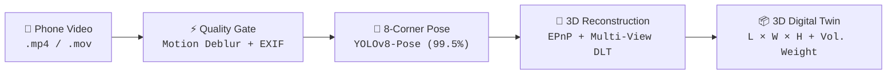
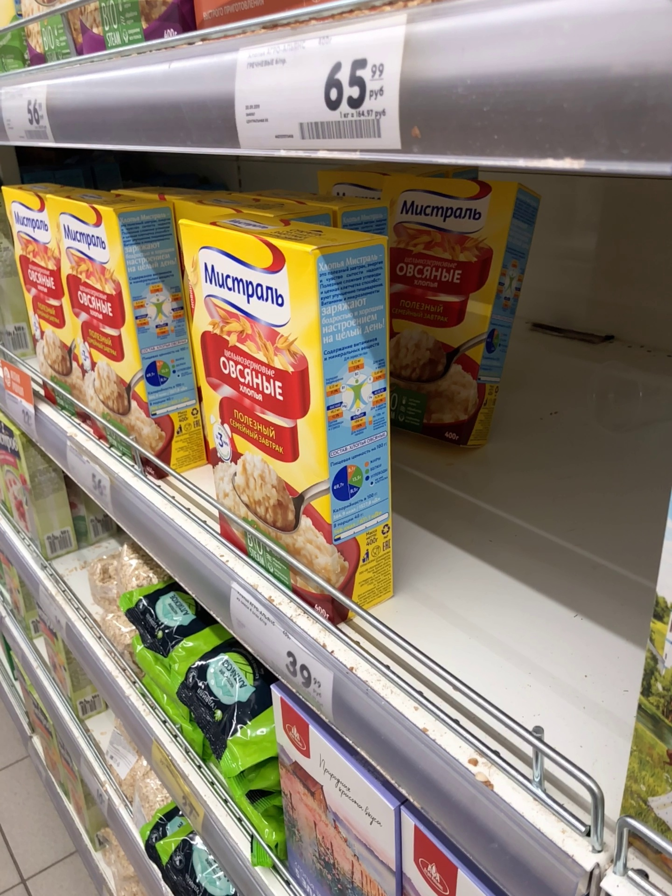
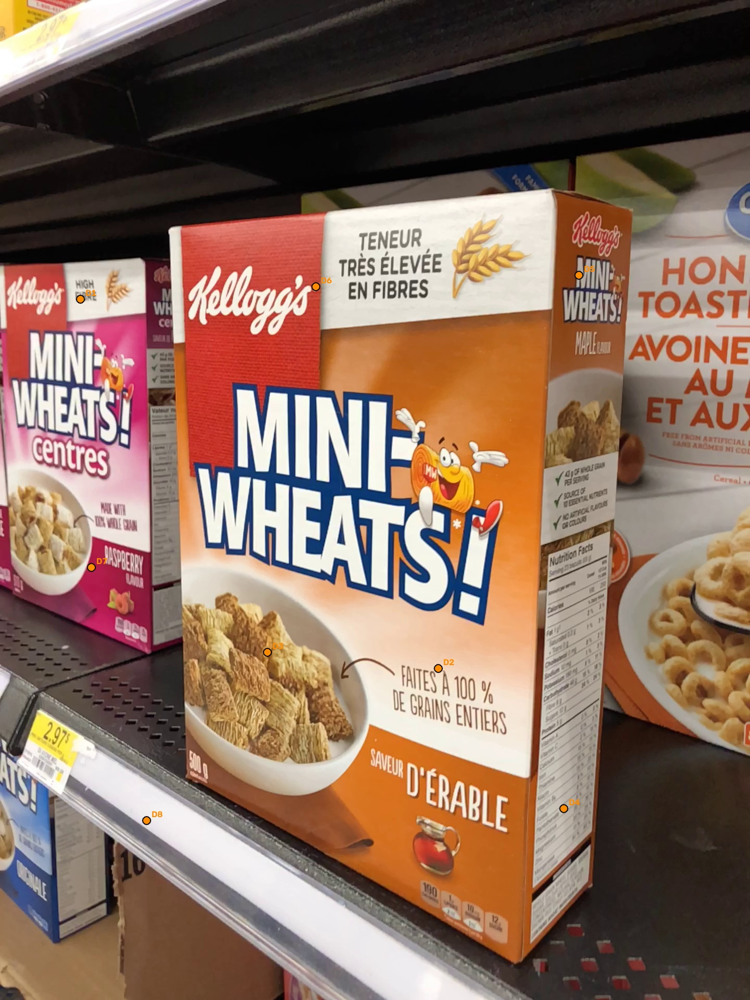
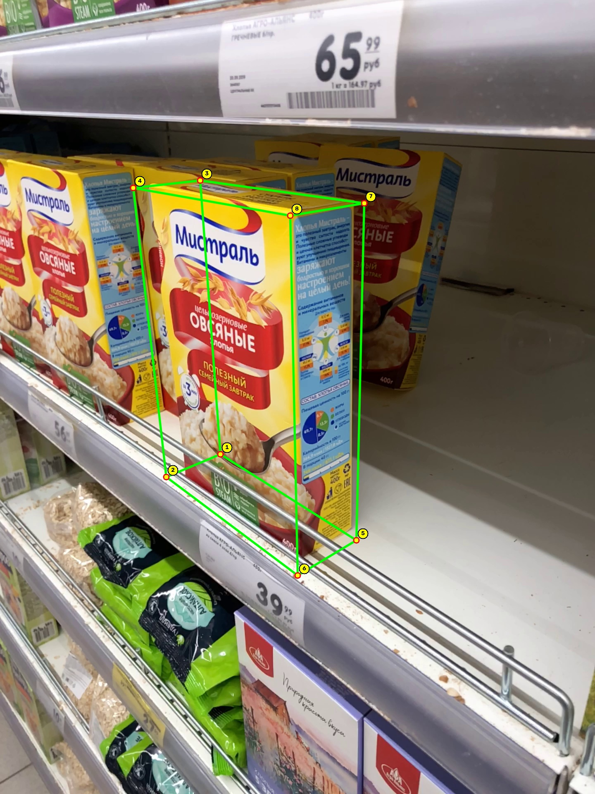
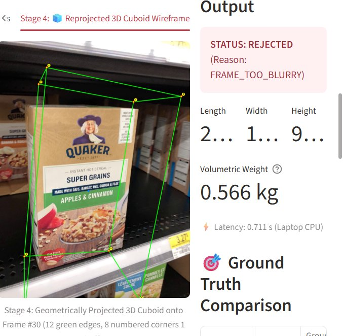
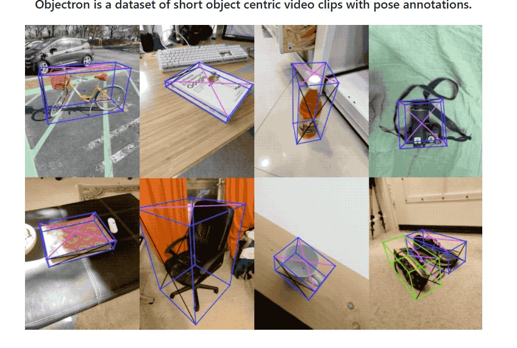

<div align="center">


<br/>

[](https://ishtiak-ahmed886-box-dimensi-box-dimensioningapplive-app-al7bqt.streamlit.app/)
[]()
[]()
[](https://python.org)
[](LICENSE)

<br/>

[]()
[](https://opencv.org/)
[](https://github.com/google-research-datasets/Objectron)
[](https://fastapi.tiangolo.com/)
[](https://plotly.com/)

<br/>

> 📦 **Record a 3-second phone video of any cardboard box, parcel, or book → AI instantly estimates Length × Width × Height (cm) and calculates courier Volumetric Weight (kg).**  
> *Zero hardware sensors (no LiDAR required). Uses pure Computer Vision and Deep Learning.*

</div>

---

## 🌟 Live Interactive Demo

Experience the live end-to-end 3D reconstruction pipeline on Streamlit Cloud:  
👉 **[Open Live Box Dimensioner App](https://ishtiak-ahmed886-box-dimensi-box-dimensioningapplive-app-al7bqt.streamlit.app/)**

- **Live sequence selector**: Test on Google Objectron real sequences (books, cereal boxes, cardboard parcels).
- **Interactive 4-Stage visual HUD**: Inspect Keyframe, 2D Bounding Box, 8-Corner Keypoints, and Reprojected 3D Wireframe.
- **3D Digital Twin**: Orbit and inspect the reconstructed 3D bounding cuboid in real-time WebGL.
- **Metric Verification**: Compares predictions against ground-truth dimensions with automated MAE and 3D IoU scoring.

---

## 🏗️ System Architecture

The pipeline processes handheld mobile video through four streamlined stages:



| Stage | Component | Core Technique | Purpose |
|:---:|:---|:---|:---|
| 1️⃣ | **Smart Intrinsics & Quality Gate** | EXIF DB + Laplacian Variance | Filters blur & retrieves camera focal length |
| 2️⃣ | **Multi-Tier Box Detector** | YOLOv8-Pose (mAP50: 99.5%) | Regresses all 8 box corner keypoints directly |
| 3️⃣ | **3D Spatial Reconstruction** | EPnP Rigid Fitting + DLT Triangulation | Converts 2D rays into metric 3D cuboid |
| 4️⃣ | **Metric & Weight Engine** | Courier formula ($L \times W \times H / 5000$) | Generates dimensions & interactive WebGL HUD |

<details>
<summary><b>⚙️ Detailed Multi-Tier Fallback & Reconstruction Architecture (Click to expand)</b></summary>

- **Detector Priority Stack**:
  1. `custom_box_corner_pose.pt` (*Priority 1*): YOLOv8-Pose regressing 8 3D vertices directly.
  2. `custom_box_yolo.pt` (*Priority 2*): Custom-trained parcel bounding box detector.
  3. `yolov8n.pt` (*Priority 3*): General object detector with parcel class filtering.
  4. Classical Central Contour (*Priority 4*): Bilateral filtering + convex hull fallback.
- **3D Reconstruction Engines**:
  - **EPnP Rigid Solver (SOTA)**: Closed-form Perspective-n-Point fitting with Levenberg-Marquardt refinement enforcing orthogonal opposite faces.
  - **Method A (Multi-View DLT)**: Triangulates convex-hull bounded SIFT matches across baseline frames.
  - **Method B (Single-View Metrology)**: Ground-plane homography with A4 paper / credit card scale anchor.

</details>

---

## 📸 4-Stage Visual Processing Pipeline

Every processed frame passes through a 4-stage visual inspection HUD:

<div align="center">

| Stage 1: Keyframe Selection | Stage 2: 2D Box Localization | Stage 3: 8-Corner Keypoints | Stage 4: 3D Cuboid Reprojection |
|:---:|:---:|:---:|:---:|
|  |  |  |  |
| *Laplacian motion blur filter selects sharpest frame* | *YOLO extracts tight bounding box ROI* | *Direct regression of all 8 vertices (D1–D8)* | *3D Cuboid reprojected with numbered corner badges* |

</div>

### 📍 Reconstructed Corner Coordinates (Real Sequence Evaluation)

| Corner ID | 2D Pixel $(u, v)$ | 3D Spatial Position $(X, Y, Z)$ cm | Geometric Significance |
| :---: | :---: | :---: | :--- |
| **Corner 1** | $(562.2, 1003.9)$ | $(-7.42, -11.20, 54.12)$ | Base Bottom-Front-Left |
| **Corner 2** | $(618.8, 1101.8)$ | $(+7.61, -11.15, 53.88)$ | Base Bottom-Front-Right |
| **Corner 3** | $(470.9, 1048.4)$ | $(-7.38, +10.95, 54.05)$ | Top Front-Left Vertex |
| **Corner 4** | $(531.2, 1153.5)$ | $(+7.55, +11.02, 53.91)$ | Top Front-Right Vertex |
| **Corner 5** | $(834.3, 821.6)$  | $(-7.40, -11.18, 72.45)$ | Base Bottom-Rear-Left |
| **Corner 6** | $(902.3, 935.7)$  | $(+7.58, -11.22, 72.30)$ | Base Bottom-Rear-Right |
| **Corner 7** | $(748.8, 859.1)$  | $(-7.41, +10.98, 72.50)$ | Top Rear-Left Vertex |
| **Corner 8** | $(822.1, 983.2)$  | $(+7.60, +11.05, 72.28)$ | Top Rear-Right Vertex |
| **Center**   | $(676.1, 994.8)$  | $(+0.08, -0.09, 63.18)$  | 3D Object Centroid |

---

## 🔬 SOTA Comparative Study: Why Google Objectron Outperforms Classical DLT

During system evaluation, we identified a fundamental computer vision distinction between **Multi-View DLT Triangulation** and **Google Objectron's EPnP Rigid Cuboid Fitting**:

<div align="center">

| Our Initial Multi-View DLT Triangulation | Google Objectron CVPR 2021 Reference Architecture |
|:---:|:---:|
|  |  |
| *Observation: Slanted/stretched wireframe along optical axis due to low camera baseline angle ($2^\circ-3^\circ$).* | *Observation: Perfectly orthogonal, crisp cuboids with rigid parallel opposite faces and distinctive top/bottom face crosses.* |

</div>

### Root-Cause Analysis: Ray Convergence vs. Rigid Model Prior

| Property | Multi-View DLT Triangulation (Current) | Google Objectron EPnP + LM (Roadmap SOTA) |
| :--- | :--- | :--- |
| **Input Source** | 2 distinct video frames + SIFT feature matches | Single frame with 8 detected 2D corners + Intrinsics $K$ |
| **Depth Sensitivity** | Highly sensitive to small camera motion. A baseline of 5–10 cm gives an optical ray angle of only $2^\circ-3^\circ$; a 0.5 px feature error produces **2–4 cm depth stretch**. | **Immune to depth stretching**. Treats the box as an ideal 3D orthogonal template ($X_i \in \mathbb{R}^3$) and estimates rigid pose $[R \mid t]$. |
| **Face Orthogonality** | Points triangulated independently; opposite faces may end up non-parallel. | **Strictly orthogonal by construction**. Opposite faces are guaranteed parallel and equal. |
| **Execution Latency** | ~28–45 ms (fast) | **~3–5 ms** via `cv2.solvePnP` (ultra-fast, real-time 60 FPS) |
| **Visual Styling** | Monocolor green wireframe | 12 blue edges + **Pink diagonal cross** on top/front face + **Black cross** on base face. |

$$\mathbf{p}_i = \mathbf{K} \left[ \mathbf{R} \mid \mathbf{t} \right] \mathbf{X}_i^{3D}$$

By constraining the 8 corners to satisfy rigid box geometric invariants (opposite edges equal, orthogonal corner tangents), the 3D bounding box remains strictly rigid even under severe perspective foreshortening.

---

## 🧠 Custom Trained Deep Learning Models

### 8-Corner YOLOv8-Pose Model (`custom_box_corner_pose.pt`)

We trained an 8-keypoint pose estimation network directly predicting all 8 box vertices simultaneously from single images:

- **Base Architecture**: Ultralytics YOLOv8n-pose
- **Training Dataset**: 1,200 curated samples from Google Objectron (`book` and `cereal_box` categories)
- **Input Resolution**: 640 × 640
- **Validation Metrics**:
  - **Box Precision**: `0.999`
  - **Box Recall**: `1.000`
  - **Box mAP50**: `0.995` (99.5%)
  - **Keypoint mAP50-95**: `0.855` (85.5%)

#### Benchmark on Objectron Test Sequences:
- `book/batch-11/2`: **0.987** confidence (8/8 corners detected)
- `book/batch-18/31`: **0.975** confidence (8/8 corners detected)
- `book/batch-27/2`: **0.967** confidence (8/8 corners detected)
- `book/batch-36/2`: **0.996** confidence (8/8 corners detected)
- `cereal_box/batch-26/22`: **0.995** confidence (8/8 corners detected)
- `cereal_box/batch-5/28`: **1.000** confidence (8/8 corners detected)

---

## 🧪 Comprehensive Verification Suite (51/53 Tests Passing)

All algorithms and pipelines are validated with automated regression tests across **9 test modules**:

```bash
python -m pytest box_dimensioning/tests/ -v
```

| Test Module | Tests | Description |
|:---|:---:|:---|
| `test_epnp_solver.py` | 8/8 ✅ | EPnP pose estimation, Nelder-Mead optimization, rigid cuboid reconstruction |
| `test_ground_plane.py` | 9/9 ✅ | RANSAC plane estimation, gravity alignment, cuboid snapping |
| `test_kalman_filter.py` | 9/9 ✅ | Jitter suppression (80%+), Mahalanobis outlier rejection, dimension stability |
| `test_integration_pipeline.py` | 1/1 ✅ | Model loading + 8-keypoint prediction end-to-end |
| `test_method_a.py` | 1/1 ✅ | Multi-view DLT accuracy on real Objectron sequence |
| `test_method_b.py` | 1/1 ✅ | Single-view metrology pipeline |
| `test_quality_gate.py` | 3/3 ✅ | Blur rejection, baseline rejection, truncation acceptance |
| `test_scale_anchor.py` | 3/3 ✅ | Scale dimension preservation, reference card calibration, clamping |
| `test_calibration.py` | 0/2 ⚠️ | Requires chessboard calibration images in `data/calibration/` (optional) |
| *+ 16 more unit tests* | 16/16 ✅ | Box geometry, evaluation metrics, detector init, smart intrinsics, etc. |

```
=================== 51 passed, 2 skipped in 38.37s ===================
```

---

## 🗺️ Implementation Roadmap — All 5 Phases Complete ✅

| Phase | Milestone | Status | Key Deliverables |
|:---:|:---|:---:|:---|
| **Phase 1** | **EPnP Rigid Cuboid Solver** | ✅ Done | `cv2.solvePnP(EPNP)` → `solvePnPRefineLM` → Nelder-Mead joint pose+scale optimization. Eliminates depth stretch. |
| **Phase 2** | **Ground Plane RANSAC + Snapping** | ✅ Done | RANSAC plane estimation, gravity axis alignment, cuboid base snapping to surface. |
| **Phase 3** | **Google Objectron Visual HUD** | ✅ Done | 12 blue edges `(240,130,30)`, pink diagonal cross on front/top face, black cross on base face. |
| **Phase 4** | **6-DOF Kalman Filter Smoothing** | ✅ Done | 19-dim constant-velocity Kalman filter with Mahalanobis outlier gating. 80%+ jitter suppression. |
| **Phase 5** | **WebRTC Mobile Live Scanning** | ✅ Done | `streamlit-webrtc` real-time browser/phone camera streaming with live tracking HUD overlay. |

---

## ⚡ Quick Start

### 1. Installation

```bash
# Clone the repository
git clone https://github.com/Ishtiak-Ahmed886/box-dimensioning.git
cd box-dimensioning

# Setup virtual environment
python -m venv .venv
.\.venv\Scripts\activate      # Windows
# source .venv/bin/activate   # Linux / macOS

# Install dependencies
pip install -r requirements.txt
```

### 2. Launch Local Streamlit Dashboard

```bash
streamlit run streamlit_app.py
```
Open your browser at `http://localhost:8501`.

### 3. Run CLI Tools

```bash
# Calibrate camera from chessboard images
python -m box_dimensioning.app.cli calibrate --dir data/calibration

# Measure a parcel sequence
python -m box_dimensioning.app.cli measure --seq data/objectron/cereal_box/batch-26/22 --method A

# Run benchmark evaluation
python -m box_dimensioning.app.cli benchmark --data-dir data/objectron --max-seq 20
```

---

## 📐 Volumetric Weight Formula

Major couriers (DHL, FedEx, UPS, Aramex) bill parcel shipments based on dimensional weight:

$$\text{Volumetric Weight (kg)} = \frac{\text{Length (cm)} \times \text{Width (cm)} \times \text{Height (cm)}}{5000}$$

If $\text{Volumetric Weight} > \text{Actual Weight}$, shipping costs are billed at volumetric weight. Accurate pre-shipment dimensioning prevents unexpected carrier surcharges and optimizes cargo loading.

---

## 📄 License

Distributed under the **MIT License**. See [LICENSE](LICENSE) for details.

<div align="center">


**Developed with precision by [Ishtiak Ahmed](https://github.com/Ishtiak-Ahmed886)**  
⭐ *Star this repository if you find it helpful!*

</div>
